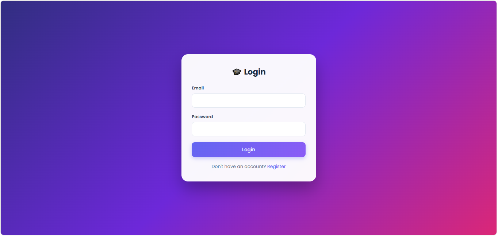
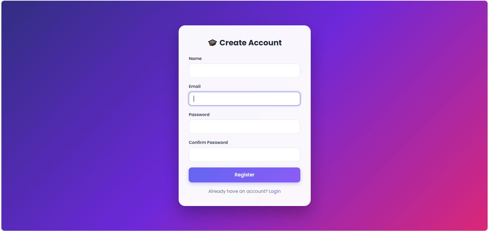
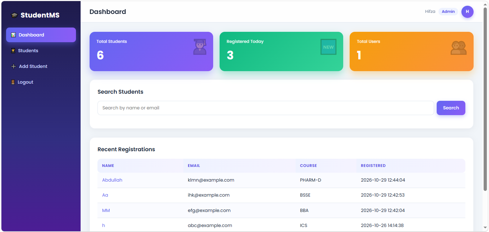
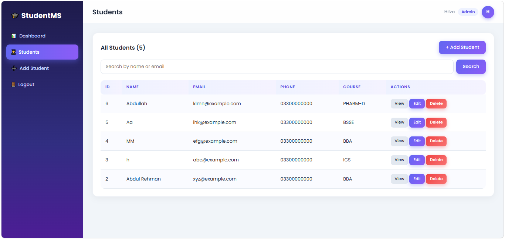
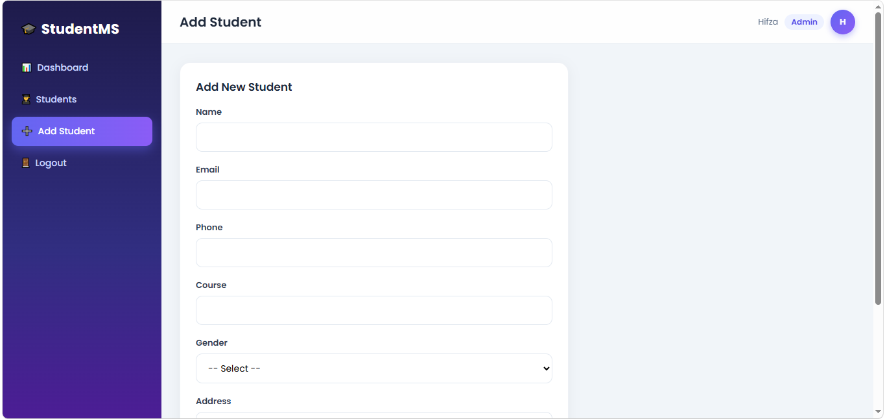
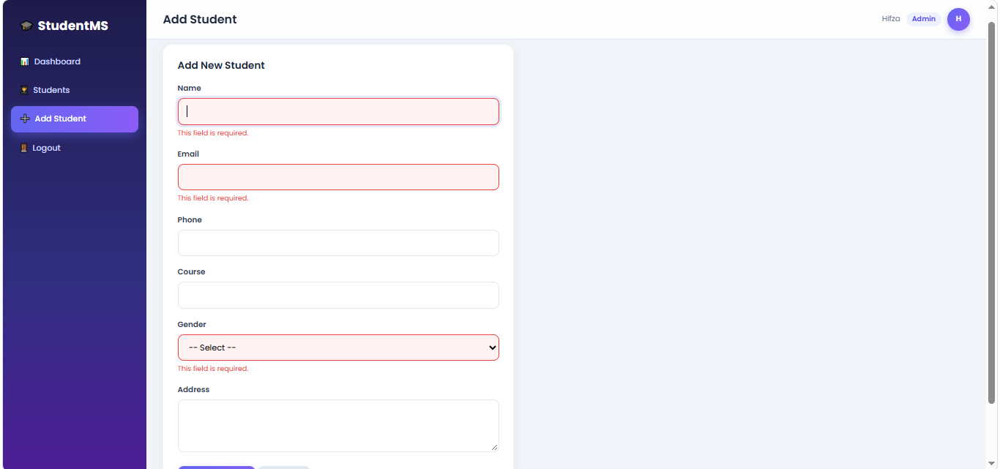
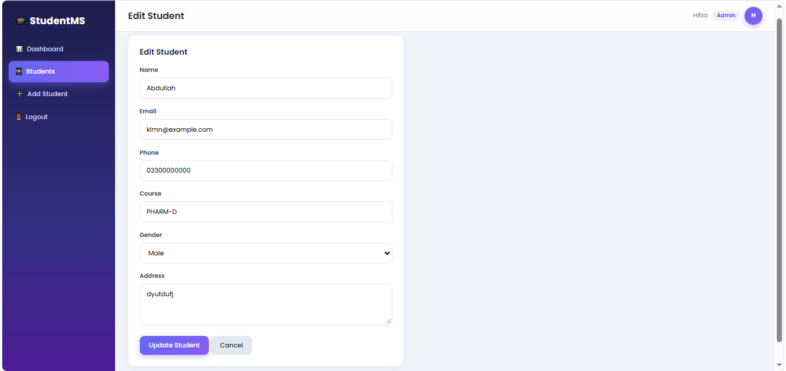
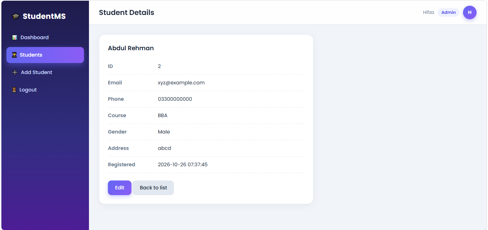
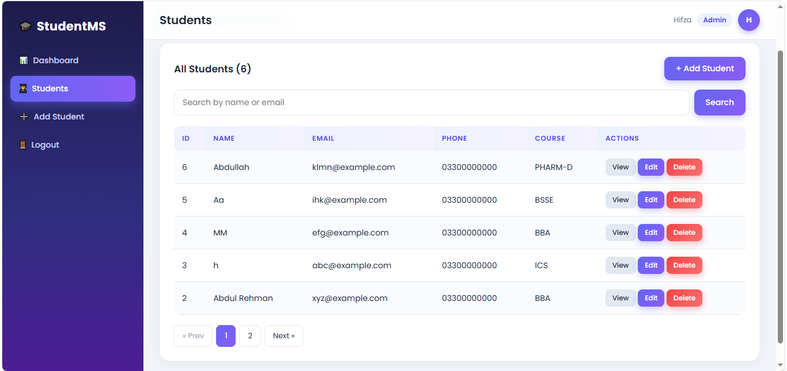

# 🎓 Student Management System

A full stack Student Management System with authentication and database integration, built for the **Devixo Solutions Web Development Internship (Week 3, Task 03)**.

## 🛠️ Tech Stack

- **Frontend:** HTML5, CSS3, JavaScript
- **Backend:** PHP (PDO)
- **Database:** MySQL / MariaDB
- **Local Server:** XAMPP (Apache + MySQL)

## ✨ Features

### Authentication
- Register, Login and Logout
- Passwords hashed with `password_hash()` and verified with `password_verify()`
- Session-based access control (protected pages redirect to login)

### Student Module
- Add Student
- Edit Student
- Delete Student (Admin only)
- Search Student by name or email
- View Student Details

### Dashboard
- Total Students
- Registered Today
- Total Users
- Recent Registrations
- Search bar
- Statistics cards

### UI / UX
- Responsive design (desktop, tablet and mobile)
- Professional dashboard with sidebar and topbar
- Client-side form validation (JavaScript) and server-side validation (PHP)
- Loading spinner on form submit

### Bonus
- Pagination (5 students per page, works with search)
- Role-based login (Admin / User)

## 🔒 Security

- PDO prepared statements to prevent SQL injection
- `htmlspecialchars()` on all output to prevent XSS
- Hashed passwords (no plain text storage)
- Delete action is POST-only and restricted to Admin

## 📁 Project Structure

```
student-management/
├── assets/
│   ├── css/style.css
│   └── js/validation.js
├── auth/
│   ├── login.php
│   ├── register.php
│   └── logout.php
├── config/
│   └── db.php
├── includes/
│   ├── auth_check.php
│   ├── header.php
│   └── footer.php
├── students/
│   ├── add.php
│   ├── edit.php
│   ├── delete.php
│   ├── list.php
│   └── view.php
├── screenshots/
├── dashboard.php
├── database.sql
└── README.md
```

## 🗄️ Database Design

**users**

| Column | Type | Notes |
|---|---|---|
| id | INT | Primary key, auto increment |
| name | VARCHAR(100) | Required |
| email | VARCHAR(100) | Unique, required |
| password | VARCHAR(255) | Hashed |
| role | ENUM('admin','user') | Default: user |
| created_at | TIMESTAMP | Default: current time |

**students**

| Column | Type | Notes |
|---|---|---|
| id | INT | Primary key, auto increment |
| name | VARCHAR(100) | Required |
| email | VARCHAR(100) | Unique, required |
| phone | VARCHAR(20) | Optional |
| course | VARCHAR(100) | Optional |
| gender | ENUM('Male','Female','Other') | |
| address | TEXT | Optional |
| created_at | TIMESTAMP | Default: current time |

## ⚙️ Setup Instructions

1. Install [XAMPP](https://www.apachefriends.org) and start **Apache** and **MySQL** from the XAMPP Control Panel.
2. Copy this project folder to `C:\xampp\htdocs\student-management`.
3. Open `http://localhost/phpmyadmin`.
4. Create a new database named `student_db`.
5. Select `student_db`, go to the **Import** tab and import the `database.sql` file.
6. If your MySQL username or password is different, update them in `config/db.php`.
7. Open `http://localhost/student-management/auth/register.php` and create an account.
8. Login at `http://localhost/student-management/auth/login.php`.

### Creating an Admin
New accounts are created with the `user` role. To make an Admin:
1. Open phpMyAdmin → `student_db` → `users` → **Browse**.
2. Click **Edit** on your row, change `role` to `admin` and save.
3. Logout and login again.

## 👥 Roles

| Action | User | Admin |
|---|---|---|
| View dashboard | ✅ | ✅ |
| Add / Edit / View / Search students | ✅ | ✅ |
| Delete students | ❌ | ✅ |

## 📸 Screenshots

### Login


### Register


### Dashboard


### Students List


### Add Student


### Form Validation


### Edit Student


### Student Details


### Pagination


## 👩‍💻 Author

Developed by **Hifza** as part of the Devixo Solutions Web Development Internship.